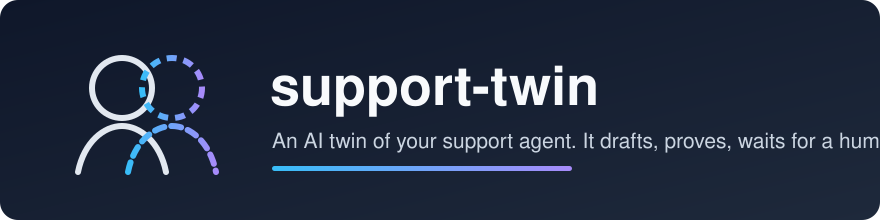
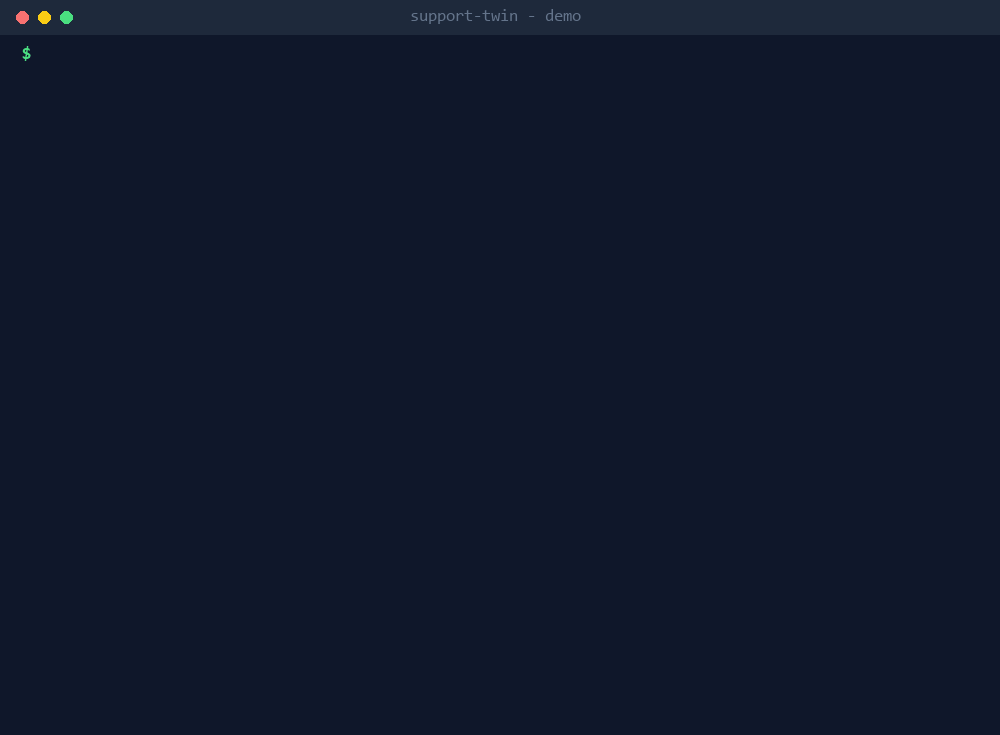
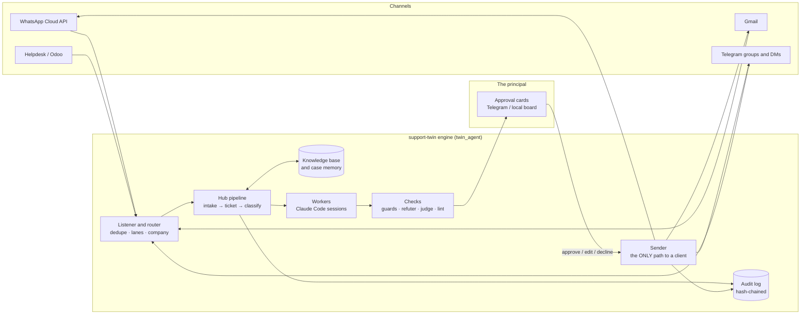
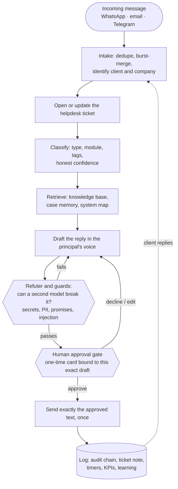

<div align="center">



**An open-source, self-hosted AI "digital twin" of your support agent: it reads every channel, opens the ticket, investigates, drafts the reply in your voice, proves the fix, and sends nothing until a human taps Approve.**

[](https://github.com/Shadysmetools/support-twin/actions/workflows/ci.yml)
[](LICENSE)
[](pyproject.toml)



<sub>`support-twin demo`: one synthetic ticket end to end. Every external system is a fake; nothing leaves your machine. (<a href="assets/demo.mp4">MP4</a>)</sub>

⭐ **Star the repo if this is useful.** It helps other support teams find it.

</div>

---

## Contents

[Why](#why) · [Features](#features) · [Architecture](#architecture) · [Install in 2 minutes](#install-in-2-minutes) · [Create your own twin](#create-your-own-twin) · [Configuration](#configuration-reference) · [Safety model](#the-human-in-the-loop-safety-model) · [Bring your own helpdesk](#bring-your-own-helpdesk) · [Evals and testing](#evals-and-testing) · [Roadmap](#roadmap) · [Contributing](#contributing) · [License](#license--commercial-use)

## Why

A good support agent spends most of the day on things a machine could prepare: reading the same question on WhatsApp,
email and Telegram, opening a ticket, chasing a screenshot, digging through past cases, writing "we're looking into
it", and remembering to follow up. The judgement calls (*is this right? can we promise that? is it really fixed?*) are
the part only they can do.

Chatbots try to replace the agent and fail on exactly those calls. **support-twin does the opposite.** It is a
*twin* of one named person (the **principal**). It does the preparation the way they would, then hands them a
one-tap decision. It never claims a fix it has not proven, and nothing reaches a client without a human approval.

## Features

- 📥 **Every channel, one queue.** WhatsApp Cloud API, Gmail, Telegram groups and DMs, and the helpdesk itself. Dedupe,
  burst-merge and reopen detection included.
- 🎫 **Ticket-first.** Every request becomes a helpdesk (Odoo) ticket with type, module, tags and an **honest
  confidence** (GREEN / AMBER / RED) earned from evidence, never a made-up number.
- 🧠 **Knowledge and memory.** A local knowledge base built from your past tickets, mail and runbooks, plus a case
  memory and a system map that grow with every resolved ticket.
- ✍️ **Replies in the principal's voice.** Persona templates, a wording linter, and a refuter: a second, independent
  model tries to break every draft before a human sees it.
- 🔬 **Prove before you claim.** A gated flow (reproduce → read the code → refute → smallest safe change → proof)
  captures evidence before any "it's fixed" message is even drafted.
- 🖐️ **Human-in-the-loop by construction.** One-time approval cards on Telegram or a local board, bound to the exact
  draft. Approve, edit or decline. Working-day SLA timers keep anyone from waiting forever.
- 🛡️ **Guardrails in code.** A kill switch, observe mode, redaction, prompt-injection wrapping, API-only helpdesk access
  and hard browser bans. Tests block all network access.
- 📊 **Flight recorder.** An audit log with a hash chain, a monitor and auditor, timesheets from real activity, and a
  golden-set eval gate for every prompt or routing change.

## Architecture



### The request flow, end to end



| Package | What it does |
|:--|:--|
| `twin_agent/listener.py`, `router.py`, `flow.py` | The main process: event bus, routing, lanes and timers |
| `twin_agent/hub/` | The support hub pipeline: intake, ticket, classify, approve, resolve, admin UI, staging and production runners |
| `twin_agent/channels/` | WhatsApp, Gmail, Telegram (bot + user client) and the helpdesk read-back adapters |
| `twin_agent/helpdesk/` | Helpdesk (Odoo) writes behind a guard, ticket analyst, conventions and ledger |
| `twin_agent/checks/` | Guards, refuter (cross-model), judge, injection wrapping, reply checker |
| `twin_agent/kb/`, `memory/` | Knowledge-base build and search, case memory, system map |
| `twin_agent/worker/`, `spawner.py` | Worker prompts and schemas; spawns sandboxed Claude Code sessions per request |
| `twin_agent/proof/`, `browser/` | Proof capture (video, OCR) in a dedicated, locked-down browser profile |
| `twin_agent/monitor/`, `timesheets/`, `watcher/` | Flight recorder and auditor, activity timesheets, learning how the principal works |
| `twin_agent/profile.py` | **Your organisation**: every company, client, mailbox and host in one place |

## Install in 2 minutes

You need **Python 3.12+** and git. Verified on Windows (PowerShell and Git Bash); Linux and macOS are best-effort
for now (the core has no Windows-only dependency, but CI runs on Windows only).

**Linux / macOS / Git Bash**
```bash
git clone https://github.com/Shadysmetools/support-twin && cd support-twin
./scripts/install.sh               # venv + pip install -e .[test] + .twin/config/config.yaml + .env
source .venv/bin/activate          # Git Bash on Windows: source .venv/Scripts/activate
support-twin demo
```

**Windows PowerShell**
```powershell
git clone https://github.com/Shadysmetools/support-twin; cd support-twin
powershell -NoProfile -ExecutionPolicy Bypass -File scripts\install.ps1
.\.venv\Scripts\Activate.ps1
support-twin demo
```

**Docker** (experimental, not covered by CI yet)
```bash
docker compose run --rm twin           # the synthetic demo
docker compose run --rm twin doctor    # the resolved profile and paths
```

Add `--live` (bash) or `-Live` (PowerShell) to also install the real-integration SDKs (Telegram, Gmail, Groq, PDF).
Run `support-twin doctor` at any time to see the home folder, config and profile in use.

## Create your own twin

1. **Describe your organisation.** Open `.twin/config/config.yaml` and edit the `profile:` block at the top:

   ```yaml
   profile:
     principal_name: "Alex"                  # the human the twin works for
     company_name: "Acme Support"            # your support team
     our_domains: ["example.com"]
     helpdesk_email: "help@example.com"
     helpdesk_host: "helpdesk.example.com"   # Odoo host: API only, never a browser
     client_name: "Globex"                   # the client the principal supports
   ```

2. **Give it the principal's voice.** Edit `twin_agent/hub/persona/support_persona.md` (who speaks, tone, never-say
   list) and `twin_agent/hub/persona/messages.yaml` (fixed client strings). Worker behaviour lives in
   `twin_agent/worker/CLAUDE.md` and `twin_agent/worker/prompts/`. Or let the twin interview the person:
   `support-twin onboard`.
3. **Teach it your history.** Point `kb_sources` in the config at exported tickets, mail and runbooks, then run
   `support-twin kb-build`.
4. **Connect channels, still in observe mode.** Store secrets in the local vault (`support-twin creds set <name>`;
   names are shown, values never are), fill in the chat and mailbox ids, and keep `run_mode: dry_run` and
   `send_enabled: false`. `support-twin setup` walks through each integration.
5. **Prove the guards, then go live one lane at a time.** Run `support-twin guards-scan --selftest`. Then switch
   `run_mode: live` with `send_enabled: false` and watch the cards. Turn on sends only when you trust them.

## Configuration reference

Configuration lives in `$TWIN_AGENT_HOME/config/config.yaml` (copied from [`config.example.yaml`](config.example.yaml),
which documents every key inline). Environment variables are in [`.env.example`](.env.example).

| Key | Default | Purpose |
|:--|:--|:--|
| `profile.*` | Acme Support / Globex | Organisation, client, principal, mailboxes, hosts, protected numbers ([`profile.py`](twin_agent/profile.py)) |
| `run_mode` | `dry_run` | `dry_run`: every adapter is a fake. `live`: real adapters for reading |
| `send_enabled` | `false` | Master switch for any client-facing send (still gated by approvals and guards) |
| `team_bus` | `telegram` | Where internal ticket threads go (`telegram` or the post-only `teamhub` webhook) |
| `people` | ids `0` | Telegram ids of the principal (the only approver), supervisor and backups |
| `chats`, `mailboxes` | empty | Allow-lists: events from anything else are dropped in memory |
| `dial` | `observe` / `off` | Per-lane autonomy dial: `off`, `observe` (draft + card only) or `auto` |
| `timers`, `holidays` | working days | Holding replies, follow-ups and SLA on working days (clock: `Africa/Cairo`, Sun-Thu week; see `twin_agent/clock.py`) |
| `guards`, `consent` | strict | Rate caps, recipient allow-lists and the consent records sends depend on |
| `persona` | template | Signature, languages, wording rules |
| `claude`, `verify` | local session | Worker model, allowed tools, refuter backend (`claude` or `groq`) |
| `kb_sources`, `memory` | empty | Knowledge-base inputs and memory settings |
| `helpdesk`, `odoo_sys`, `odoo_client` | off | Helpdesk writes and the read-only Odoo access for workers |
| `proof`, `browser` | off | Proof capture and the dedicated browser profile |
| `voice`, `whatsapp` | off | Voice-note replies and WhatsApp Cloud API |
| `monitor`, `watcher`, `timesheets` | off | Flight recorder, learning, timesheets |

| Environment variable | Purpose |
|:--|:--|
| `TWIN_AGENT_HOME` | Home for `config/`, `data/` and logs (install scripts: `./.twin`; otherwise `C:\TwinAgent` on Windows, `~/.twin-agent` elsewhere) |
| `TWIN_PROFILE` | Optional separate persona/profile YAML |
| `TWIN_AGENT_VAULT_DIR` | Optional location of the encrypted local vault |
| `GROQ_API_KEY`, `ANTHROPIC_API_KEY`, ... | Optional model keys (the default worker is a local Claude Code session) |

## The human-in-the-loop safety model

support-twin is built so that the **safe outcome is the default and every risky action needs a human and a test**:

1. **Observe by default.** A fresh install runs `run_mode: dry_run` with `send_enabled: false`: every adapter is a fake
   and no message can leave.
2. **One sender.** `twin_agent/sender.py` is the only code that can talk to a client. Everything else produces drafts
   and cards.
3. **Approval is bound to the draft.** Each approval card carries a one-time nonce and the hash of the exact text. Only
   the configured principal's account can approve. A tap sends that text once, and an edited draft needs a new tap.
4. **Guards before every send.** Recipient allow-lists, rate caps, consent records, secret and PII scanning, wording
   lint, and a kill switch (a `STOP` file blocks everything and alerts the principal and backups).
5. **Honest confidence.** GREEN needs checked evidence. A different model (the refuter) must fail to break the answer.
   Nothing is called fixed without proof.
6. **Least privilege.** The helpdesk is reached by API only and never through a browser. Client databases are read-only.
   The proof browser runs in its own locked profile with banned hosts. Workers run with a deny-by-default tool list.
7. **No network in tests.** `conftest.py` makes every non-loopback connection fail, so the suite can never reach a real
   service by accident.
8. **Everything is recorded.** An append-only, hash-chained audit log, plus the monitor that flags any production
   write without the required approvals.

## Bring your own helpdesk

These integrations exist in the code today. Each one is behind a config switch and **off by default**:

| Integration | Where | Notes |
|:--|:--|:--|
| Odoo Helpdesk (JSON-RPC) | `twin_agent/helpdesk/`, `hub/odoo_gateway.py`, `testing/fake_odoo.py` | Ticket create and update, stages, notes, people. Writes go through a guard |
| Odoo read-only access for workers (MCP) | `channels/mcp_odoo_client_read.py` | `search_read` / `read` / `fields_get` only, https Odoo Online hosts, vault key |
| WhatsApp Cloud API | `channels/whatsapp_cloud.py`, `hub/webhook.py`, `hub/admin/` | Webhook intake, 24h-window rules, embedded-signup admin UI |
| Gmail | `channels/gmail_in.py`, `gmail_send.py` | Read and reply on allow-listed mailboxes, tickets by email |
| Telegram | `channels/bot_api.py`, `tg_client.py`, `telegram_in.py` | Approval cards (bot) and group intake (user client) |
| Team chat bus | `hub/team_bus.py`, `hub/teamhub_*.py` | Optional post-only team threads with PII stripped |
| Knowledge wiki | `hub/fakes.py` (`WikiKnowledge`), `hub/adapters_real.py` | Client context and share links |
| KPI push | `hub/adapters_real.py` (`RealMetrics`) | Resolution KPIs to your metrics tool |
| Speech-to-text and voice | `voice/`, Groq Whisper | Voice-note intake and (with consent) voice replies |
| Claude Code workers | `spawner.py`, `worker/`, `session_launch.py` | One sandboxed session per request, MCP tools for KB, history and Odoo reads |
| Browser proof capture | `browser/`, `proof/` | Playwright/CDP in a dedicated profile, OCR, narrated proof videos |

Using another helpdesk such as Zendesk, Freshdesk or Jira Service Management? The hub depends on small interfaces
(`twin_agent/hub/interfaces.py`) with fakes in `twin_agent/hub/fakes.py`. Implement the same methods against your API
and wire it in. See [CONTRIBUTING.md](CONTRIBUTING.md).

## Evals and testing

```bash
python -m pytest -q          # the full suite: thousands of unit and flow tests, no network
support-twin demo --fast     # the synthetic end-to-end run used in CI
```

- **Golden-set eval gate.** `twin_agent/hub/evalharness.py` scores classification, routing and drafts against a redacted
  golden set (`hub/fixtures/golden_set.json`, `ticket_quality_golden.json`) and fails on any regression.
- **End-to-end dry runs.** `support-twin e2e-dry-run --export <chat export>` replays a real-shaped conversation through
  the whole listener on a fake clock and proves zero sends.
- **Safety tests.** Tests cover the approval gate, the kill switch, injection, PII leaks, the host bans and the
  "never send without a tap" invariant.
- Tests that need an optional SDK (`telethon`, `keyring`, ...) or a Windows-only tool are skipped when it is missing.

## Roadmap

- [ ] First-class adapters for Zendesk, Freshdesk and Jira Service Management
- [ ] A web onboarding wizard for the persona and integrations
- [ ] A verified Linux container and Helm chart
- [ ] Pluggable model backends for workers (beyond Claude Code sessions)
- [ ] Multi-principal installs: one engine, many twins
- [ ] Timezone and working week from the profile (today: `twin_agent/clock.py`)
- [ ] Published eval dashboards per twin

## Contributing

Issues and pull requests are welcome. Read [CONTRIBUTING.md](CONTRIBUTING.md) first: safety rules, no real data in
fixtures, and organisation-specific values go in the profile, not the code. Report security issues privately (see
[SECURITY.md](SECURITY.md)).

## License & commercial use

Licensed under the **Apache License 2.0** ([LICENSE](LICENSE), [NOTICE](NOTICE)). It is free for any use, including
commercial use, modification and redistribution, under the license terms.

Want a **hosted version**, **custom integrations** or **priority support**? Open an issue or get in touch through the
maintainer's GitHub profile.

Credits: see [CREDITS.md](CREDITS.md).

---

**Built by [Shady Al-Halawani](https://github.com/Shadysmetools)**, AI Product Manager & Tech Lead · [LinkedIn](https://www.linkedin.com/in/shady-al-halawani-333a5419a) · [Book a call](https://calendly.com/shady-al-halawani)
